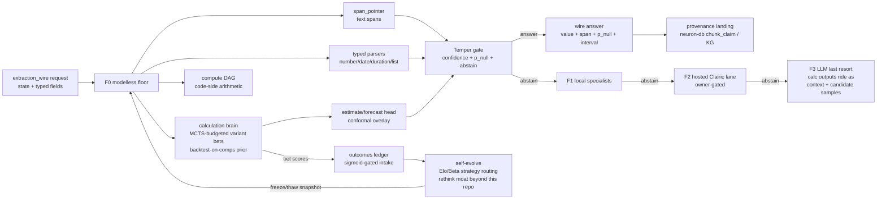

# Proposal 016 — Fathom: the modelless extraction stack (the Clairic answer)

**Status:** Proposal — Claude verdict round 2 AGREE (2026-10-20) → owner GO gates: (1) name "Fathom", (2) repo birth `riir-fathom`, (3) hosted Clairic lane spend. Phase-0 substrate (Plan 628) is NOT owner-gated and can land upstream regardless.

> **Companion:** [Research 627](../.research/627_Cloudflare_Clairic_Extraction_Models.md) (Clairic distill + prior art + scoreboard) · [Plan 628](../.plans/628_fathom_extraction_substrate.md) (Phase-0 substrate)
> **Lineage:** Proposal 014 → riir-reflex (the decision-serving family). This proposal is its extraction sibling: Proposal 014 is to Jev/Clef what this is to Clairic.
> **Classification:** Public (this file). Any private-tier evolution (trained heads) opens its own charter later — see §9.

---

## 1. TL;DR + commercial value

**Fathom** is a modelless **extraction stack** — the System One EXTRACT class (Clairic, Oct 2026 preview) answered the way we answered the DECIDE class (Reflex/Instinct/Rethink vs Jev/Clef): a pure-Rust engine that reads `state` + typed `fields` and returns grounded spans, parsed/computed numbers and dates, and conformal estimate/forecast distributions — zero weights, zero output tokens, µs–ms class, first-class abstention — behind an Instinct-style escalation ladder, with a delayed-label self-evolution loop that tightens calibration per deployment, and every answer landing as a bitemporal provenance-anchored claim in riir-neuron-db.

Selling point (one sentence): *"Fathom extracts typed, grounded, calibrated values at microsecond latency with no weights and no per-call LLM cost — and its intervals tighten on YOUR data from realized outcomes the hosted model throws away."*

The market wedge is real and fresh: extraction is "probably the most common job handed to LLMs today" (Cloudflare's words); the incumbent is generation-based (parse failures, output-token cost, run-to-run drift); Clairic validates the class but is hosted-only with weights pending and calibration "measured, not guaranteed". We build the open, deterministic, self-improving floor now — and seat Clairic as a comparison/escalation lane when its endpoint/weights arrive.

## 2. Name — decided (owner asked us to choose)

**System name: Fathom.** Rationale + seats in Research 627 §7. Short form:

- **Fathom** = the extraction stack/family (repo `riir-fathom`, public). Sounding-the-depths semantics maps literally onto all four classes (estimate = depth AS an interval). 2 syllables, sharp consonants, family-consistent (Reflex/Refine/Instinct/Rethink/Fathom). Collisions disclosed (Fathom Analytics, fathom.video — different spaces); runner-up "Plumb" if vetoed.
- **Temper** = the calibration/abstention gate inside Fathom (component name — the owner's own seat for it).
- **Intuition** = reserved for the future R2 middle rung of the DECISION ladder. Not spent here.

Wire/vocabulary names stay descriptive, not branded: `extraction_wire` (one-definition in katgpt-core), `span_pointer`, `estimate head`, `Temper gate`.

## 3. Architecture

### 3.1 The wire — `extraction_wire` (one-definition, katgpt-core)

The `decision_wire` R7-freeze shape, extraction-flavored: request = `state` + field map (`text|number|date|time|datetime|duration|list|estimate|forecast` + constraints + instructions + optional reference_date); answer = typed value + span offsets + `p_null` + `confidence` (+ median/p10/p90/p_below/p_above for estimates, per-step for forecast); `contract_version` on every request, additive-only evolution, unknown-field refused. Abstention first-class: `null` is an answer, with `guess` disclosed (Clairic's honest null-with-guess is adopted verbatim — it is good design).

No multi-pass splitting in v1: fields answer in one zero-alloc batch against the whole state (our batch is µs-class; the 8,192-token pass-split problem is a token-model problem we don't have).

### 3.2 F0 — the modelless floor engine

- **Spans (`text`, `list`):** `span_pointer` — candidate windows scored by lexical (BM25/ngram) + hashed-feature embedding similarity (the reflex `embed.rs` class) + optional per-field alias/dictionary tables; sigmoid normalization, never softmax; offsets are literal input slices (provenance for free). **Disclosed limit (scoreboard LOSS row 12):** F0 cannot READ plain-language `instructions` — it matches schema/dictionary/positional signals; instruction-conditioned extraction lands at F1 (dictionaries/prompt tables) and F2 (hosted lane).
- **Typed scalars (`number`/`date`/`time`/`datetime`/`duration`):** deterministic grammar parsers first (highest precision), span-scoring fallback; unit/integer/decimals constraints enforced by construction. **Grammar design consumes the published typed-rule-parser class — Meta Duckling (Apache-2.0) + Microsoft Recognizers-Text (MIT) — translate, never reinvent** (substrate-first applied outside the workspace).
- **Compute:** a typed field DAG — fields may declare formula edges over other fields; arithmetic/date-math executes in code, replayable, exact. Consume seal-std `seal-formula`'s pattern (translate the concept, do not rebuild an engine). This makes "multi-step arithmetic" an ARCHITECTURE guarantee, not a model limitation.
- **Estimate:** **cross-sectional conditioning** (Clairic's estimate reads evidence IN the state — a repair cost from a damage description, a price from a comps table pasted into the state). Comparables corpus, stated plainly: (a) tabular/structured content parsed FROM the state (their own home-price example carries the comps IN the request), and (b) the per-deployment outcomes ledger as it accumulates (Phase 2). Conditioning = kNN over those comparables → point predictor → `ConformalIntervalCalibrator` overlay → median/p10/p90 quantized onto the caller's grid (linear/log). **The floor law: if the conditioned head cannot beat `ConformalIntervalCalibrator<SeasonalNaiveForecaster>` (m=1) on CRPS/coverage/Winkler, the floor IS the served answer** (Report the Floor, Research 322). The time-series forecaster family (`SeasonalPoolForecaster`, KARC) serves FORECAST, not Estimate — the two classes do not share a conditioner.
- **Forecast:** the same calibrator in h-step residual mode over the time-series forecaster family; per-step intervals, horizon loop.

### 3.3 Temper — the calibration/abstention gate

Per-(field-type, domain) residual pools re-fit from realized outcomes; confidence readout dispatch inherits the Bench-817 narrow/wide precedent (the same inheritance reflex used); fused abstain = confidence ∧ corpus-distance gate (the reflex pattern, extraction-typed); abstain emits `null` + `p_null` + escalation receipt. Sigmoid everywhere, never softmax. Zero-alloc hot path (G4).

### 3.4 The self-evolve flywheel (the delta vs the vendor product)

Estimates and forecasts RESOLVE — the paid date arrives, tomorrow's count publishes — so **Estimate/Forecast labels arrive free**; Extract/Compute answers never resolve on their own and learn only from human-confirmed or downstream-verified spans (a slower, honest channel). Outcomes append to a per-deployment ledger; per-(field-type, domain) Elo + Beta-posterior selection promotes/demotes extraction STRATEGIES (parser variants, scorer configs, estimator families); routing tables + direction vectors snapshot under a BLAKE3 frozen envelope with monotonic epoch tags (instinct A2/A6 laws, riir-neuron-db machinery) and hot-swap atomically. No gradient descent anywhere in the loop (modelless-first mandate; freeze/thaw + latent routing only). **The flywheel is not exclusive to a weightless engine — Temper calibrates EVERY rung, F2 hosted included** — the delta vs Clairic-the-product is who runs the loop: the vendor does not expose per-deployment refit; Fathom runs it natively at every rung.

### 3.5 The escalation ladder (Instinct's grammar, extraction-typed)

F0 floor → F1 local specialists (domain grammars/dictionaries/plugins) → F2 hosted extraction lane (Clairic endpoint; measure-only until open weights; comparison-lane machinery cloned from reflex `src/lanes/`) → F3 LLM-JSON last resort (the incumbent, kept as the honest opponent lane). The escalation GRAMMAR is consumed from instinct's one-definition (`EscalateSpec`), byte-pinned like rethink does — never forked. Every escalation carries a receipt naming the rung and the refusal reason.

### 3.6 Provenance landing (neuron-db)

Every answer is a CLAIM: span/offsets + value + valid_time + provenance (BLAKE3 of state-slice + engine epoch). Landing zone: riir-neuron-db `chunk_claim` (bitemporal, Issue 607 substrate) and `vibe.rs` KG triples for entity/relation extractions. Raw values cross any sync boundary; latent ops stay local (the latent-vs-raw law, unchanged).

### 3.7 The calculation brain — MCTS-budgeted variant bets (Issue 952; owner directive 2026-10-20)

The estimate/forecast classes get a bounded modelless search head BEFORE any heavier path: a **"bet"** is a candidate estimator composition over the comparables corpus (median-of-comps, kNN-k, ratio scaling, recency-weighted, closed-form ratio regressions — each a small deterministic authored function); a **PUCT/MCTS search under a fixed budget** expands and evaluates bet compositions, scoring each leaf by backtest on a **selection split** of the in-state comparables (LOO/CV — the conformal overlay reads its residuals from a SEPARATE calibration split; selecting the estimator on the calibration rows breaks exchangeability, and a coverage number produced on merged comps is not a measurement; n ≤ ~8 → jackknife+/cross-conformal or the floor serves, threshold derived from the bench's comps-size axis, never a hand-typed edge). The search signal is backtest CRPS — the G1 discipline made into a tree prior. PUCT must beat an equal-budget exhaustive control or the exhaustive version ships (tens of candidates fit in b=64 — a tree that ties a sweep is latency spent on nothing). The picked bet → point + spread → conformal overlay → the answer. Finishes µs–ms by construction — before any *NN path or a freeze/thaw swap could. Every evaluated bet's score gates through a **sigmoid into the outcomes ledger** as the floor-relative skill `sigmoid(β·(CRPS_floor − CRPS_bet)/CRPS_floor)` — raw CRPS is scale-dependent and incomparable across states; the normalized skill is not (Issue-940 sequential-fold + first-index tie rule applies to anything committed/replayed; else local-only) — consolidation later, never at answer time. The brain's outputs (typed values, scored candidate bets, intervals) ride escalations as instruction context or extra candidate samples for higher lanes.

Lineage is in-repo and proven: `katgpt-moka-wasm` (wasm32+SIMD net + PUCT, wasmi/V8 bit-parity, bench 205 — PUCT beat alpha-beta 74%→98%) and `katgpt-percepta` (O(log N) 2D attention + the gate→WASM scheduling ladder). **Vehicle honesty:** wasm32 strategy packs are the ATTESTATION/distribution form (verifiable artifacts, arsenal-A2 hot-swap compatible), never the speed claim — native serves (the workspace measured wasmi ~46× slower than V8 on the same moves; the refine wasm-validator verdict measured 285× native win). **Residency: packs are arsenal artifacts and ride the instinct A7/R5 machinery — lazy posture + live capacity knob + `lru_make_room` LRU release (eager rows exempt, best-effort, tag-kept monotonic re-load) — never a bespoke pack cache** (alignment per owner directive 2026-10-20; `riir-instinct/src/serve_edge.rs` `lru_capacity`/`lru_make_room` + `src/arsenal_ops.rs` `LaneSlot` are the one implementation). The kernel (PUCT over bet variants + sigmoid score intake) is generic modelless math — public, moka-tier; the product composition is rethink moat (§9). Full tasks + gates: Issue 952.

## 4. GOAT gates

| Gate | Bar |
|---|---|
| **G1 calibration** | Estimates/forecasts MUST beat the conformal-naive floor (CRPS/empirical coverage/Winkler, the Plan-340 floor harness) — else the floor serves. Spans: conformal null-gate coverage at the declared level. |
| **G2 perf** | Full N-field request p99 budget at CPU-only posture (target µs–ms class; bar pinned in Plan 628 bench) — vs Clairic's published 0.46 s extraction leg. |
| **G3 no-regression** | katgpt-rs consumes siblings, never edits them; reflex/instinct/refine/neuron-db surfaces consumed via their pub seams only. |
| **G4 alloc-free** | Zero-alloc hot path, canary-armed counting allocator (the reflex G4 shape). |
| **G5 span parity** | External BLAKE3-pinned extraction fixture (the cua-s1-arena pinning shape — NEVER fixtures we authored for the test; our own goldens make G5 circular) + **TWO baselines**: a Duckling/Recognizers-class rule floor and a GLiNER-class trained lane. `span_pointer` earns GOAT only by beating the rule floor; ANY published head-to-head vs Clairic (hosted or open-weights) runs through the comparison lane first — measure-only, grammar-not-answers governs any corpus synthesis from its outputs. |

## 5. Repo topology + sequencing (the reflex precedent)

1. **Phase 0 — substrate upstream-first (Plan 628, NOT owner-gated):** `extraction_wire` types in katgpt-core (the `decision_wire` precedent — pure contract, additive-only) + a NEW member crate **`katgpt-extract`** for everything that GROWS: `span_pointer`, typed parsers (locale/date grammar grows — it does not belong in the core leaf), the cross-sectional estimate conditioner + forecast head, and the Temper gate substrate. Benches + G-gates. Run the `boundary-guard` skill BEFORE T0.1 (member-crate addition + any dep edge). Exactly how `Lz4FlexDrafter::score_into` landed before riir-reflex was born.
2. **Phase 1 — repo birth (OWNER-GATED):** `gist-rs/riir-fathom`, public like riir-reflex/riir-instinct: the assembled F0 engine + Temper + std-only serving edge + honest-metrics harness (extraction suites: invoices/receipts/dates/NER/forecast-series from public datasets) + arena vs the F3 LLM-JSON lane.
3. **Phase 2 — self-evolve:** outcomes ledger + Elo routing + freeze/thaw snapshots + calibration re-fit gates.
4. **Phase 3 — ladder + provenance:** ESC one-definition consumption, F2 Clairic lane (owner-gated spend), neuron-db claim landing.
5. **Phase 4 — later, each owner-gated:** site (fathom.gist.rs), KAT-plane analog of decstat, images (only at owner ask — text-first doctrine).

## 6. Phase 0 tasks (detail lives in Plan 628)

- [ ] **T0.0** boundary-guard skill BEFORE any module/crate creation (member-crate `katgpt-extract` + dep edges) — result recorded in Plan 628
- [ ] **T0.1** `extraction_wire` types in katgpt-core + contract_version refusal law (feature `extraction_wire`)
- [ ] **T0.2** `span_pointer` scorer in the NEW member crate `katgpt-extract` (feature `span_pointer`)
- [ ] **T0.3** typed parsers in `katgpt-extract`, grammar design consumed from Meta Duckling + Microsoft Recognizers-Text (translate, never reinvent)
- [ ] **T0.4** estimate (cross-sectional conditioner) + forecast (time-series family) heads in `katgpt-extract` over Plan 340 + Report-the-Floor gate harness (feature `extraction_estimate`)
- [ ] **T0.5** Temper gate: calibration + fused abstain + null-with-guess semantics
- [ ] **T0.6** benches: G2 perf bar + G4 alloc gate + G1 floor comparison + G5 external BLAKE3-pinned fixture with rule-floor AND GLiNER-class baselines — GOAT before any promotion

## 7. Owner-gated calls (explicit)

1. **Name:** Fathom (runner-up Plumb) — veto window open.
2. **Repo birth** `gist-rs/riir-fathom` (Phase 1).
3. **F2 hosted Clairic lane spend** (preview endpoint $0.10/M input tokens — metered, small; open-weights lane is free but gated on release).
4. **Any corpus synthesis from Clairic outputs** — grammar-not-answers doctrine + owner sign-off, always.
5. Private-tier evolution (trained extraction head) + the **calculation-brain-as-sample-farm posture** (Issue 952 T6) — rethink-side charters, opened when the owner says go.

> **Plan 628 is under a live claim lease** (`katgpt-rs-fathom-phase0`, expires 2026-10-22T02:03:30Z; T0.1 + the katgpt-extract scaffold landed 2026-10-20). Phase-0 tasks coordinate with the lease holder; the calculation brain is filed as Issue 952 precisely so it does NOT collide with the leased task list.

## 8. Caveats (honest)

- Images are OUT of v1 and instruction-conditioning is NOT at F0 — the scoreboard's two LOSS rows; OCR-class inputs degrade span quality vs a trained head (the SPLIT row). The floor is for clean-ish text, forms, tables-as-text, logs, emails.
- The floor's span recall ceiling is real: a weightless scorer will miss paraphrase-distant mentions a trained model catches. That is what F1/F2/F3 are FOR — the ladder, not denial.
- Forecast ambition is deliberately floored: we claim guaranteed-coverage basics, not Clairic's learned rhythm pickup, until the self-evolve loop proves otherwise on real series.
- Naming collisions (Fathom Analytics / fathom.video) are disclosed, not hidden — owner's call.

## 9. What is deliberately NOT here — and the moat boundary (owner-flagged 2026-10-20)

**The moat split (owner directive: "all this is new moat for rethink — mind boundary and mention"):**

- **PUBLIC (this repo + riir-fathom):** the open primitives — `extraction_wire`, `span_pointer`, typed parsers, the conformal estimate/forecast head, and the calculation-brain KERNEL (PUCT over bet variants, sigmoid-gated score intake — generic modelless math, the same public tier as `katgpt-moka-wasm`/`katgpt-percepta`).
- **RETHINK MOAT (private-forever, charter opens THERE, never here):** the extraction product composition — the self-evolve economy over bet/extraction outcomes, the calculation-brain-as-sample-farm posture (calculation outputs as instruction context + candidate samples feeding TRAINED lanes), any hosted-only escalation posture, and any trained extraction head. This is the rethink-class surface the research skill's public/private tier check exists for: no rethink-class product detail lands in public files beyond this pointer; when the composition work starts, its charter/proposals/plans live in `../riir-rethink`.

Also deliberately NOT here:

- No trained serving arm in the public tier, no ESC enforcement productization. The extraction trained-head question opens its OWN charter if/when the floor's G1 data says a head is worth training (riir-train), with its own public/private seam decision.
- No decision-ladder duplication: Fathom composes WITH Clef/Jev-class decision models (extract → decide → generate is their published cascade; our floor feeds decision_wire natively) — it never re-serves decisions.
