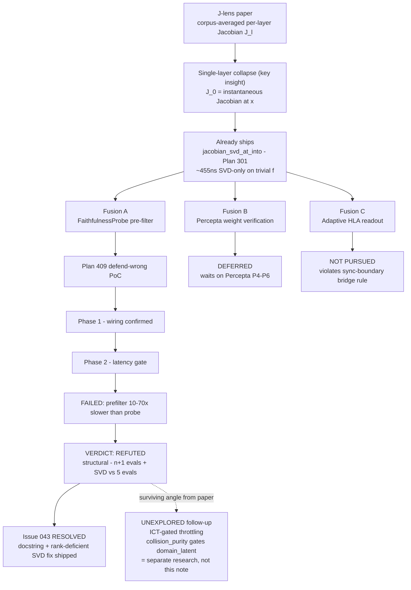

# Research 388: Jacobian-Lens Concept Readout for Single-Layer Models (Modelless)

> **Source:** "Verbalizable Representations Form a Global Workspace in Language Models" — Gurnee, Sofroniew, Lindsey, Olah et al., Transformer Circuits Thread, 2026-07-06. https://transformer-circuits.pub/2026/workspace/index.html
> **Date:** 2026-07-07
> **Status:** Closed — verdict **Refuted (Fusion A latency path)** per Plan 409 Phase 2. The prefilter is 10–70× SLOWER than the probe (not faster); root cause is structural (n+1 eval calls + SVD vs probe's 5 eval calls). The architectural insight (SVD principal directions = local concept basis) is true but has no latency value as a `FaithfulnessProbe` pre-filter. Issue 043 (SVD perf regression) **resolved** — docstring corrected + rank-deficient fast-path shipped (commit `6e2b682d`). Fusion B (Percepta verification) deferred; Fusion C (HLA readout) not-pursued (violates sync-boundary bridge rule).
> **Related Research:** 031 (Percepta deep dive), 032 (Percepta distillation), 244 (Self-Evolver FaithfulnessProbe), 277 (DiffusionGemma transparency/smearing), 290 (latent field steering), 301 (Misalignment Indicator Probe Bank), 353 (program-synthesized attention head surrogates), 379 (hierarchical global attention chunk-group routing), 382 (spherical steering), **666 (neuron-lens R/S lenses — the S-lens input-facing read + RelP hand-rule deep-stack delta; this note's prefilter refutation is single-layer finite-difference scope, restated in 666 §2.2)**
> **Related Plans:** 271 (attention matching compaction), 278 (FaithfulnessProbe), 301 (runtime subspace phase gate — ships `jacobian_svd_at`/`jacobian_svd_at_into`), 312 (viable manifold graph), 405 (spherical steering geodesic primitive), **409 (Fusion A PoC — COMPLETE, halted Phase 2, Fusion A refuted)**
> **Related Issues:** **043 (SVD perf + docstring — RESOLVED, commit `6e2b682d`)**
> **Classification:** Public

---

## TL;DR

Anthropic's "Jacobian Lens" (J-lens) reads off the principal directions of `J_ℓ = E[∂h_final/∂h_ℓ]` — the corpus-averaged per-layer Jacobian. **At 1 layer, the corpus average collapses to the instantaneous Jacobian at the current point**, which `jacobian_svd_at_into` (Plan 301) already computes. The expensive part of the paper's recipe (per-layer corpus averaging across ~1000 prompts) **disappears for our 1-layer substrate**.

**Proposed primitive:** a causally-faithful concept readout using the SVD's top-k right singular vectors as a representational pre-check before the `FaithfulnessProbe` causal probe.

**Verdict: REFUTED as a `FaithfulnessProbe` pre-filter (Plan 409 Phase 2).** The prefilter (n+1 eval calls + SVD) is **structurally slower** than the probe (5 eval calls) for n ≥ 4 — 10–70× slower at every size tested. The ~455 ns claim was measured on a trivial identity `f`, not a realistic linear map (~3.9 µs full-rank). The architectural insight (SVD principal directions = local concept basis) remains true but has no latency value as a pre-filter. Issue 043 (misleading docstring + rank-deficient SVD regression) **resolved** — docstring corrected + rank-deficient fast-path shipped (commit `6e2b682d`).

---

## Verdict map



---

## 1. Paper Core Findings

### 1.1 The Jacobian Lens (J-lens)

For each layer ℓ, define the per-layer Jacobian:

```
J_ℓ = E_prompt[ ∂h_final / ∂h_ℓ | prompt ]
```

i.e. the average sensitivity of the model's *final hidden state* to perturbations at layer ℓ, computed over a reference corpus (~1000 prompts). Rows of `W_U · J_ℓ` (where `W_U` is the unembedding) are the **J-lens vectors** — one per vocabulary token. Each vector answers: *if I perturb `h_ℓ` in this direction, does the model become more or less likely to verbalize token `t`?*

### 1.2 The J-space

The **J-space** is the sparse non-negative subframe spanned by ~25 of these J-lens vectors that together satisfy five functional properties of a Global Workspace (GWT):

1. **Verbal report** — swapping J-space directions changes the model's verbalized answer.
2. **Directed modulation** — instructions populate the J-space.
3. **Internal reasoning** — intermediate concepts (e.g. "spider" before "8 legs") appear in J-space before the final answer.
4. **Flexible generalization** — one J-space vector serves many downstream functions.
5. **Selectivity** — automatic tasks (text continuation) *do not* route through J-space; only deliberate ones do.

Structurally: J-space exists only in a **middle band of layers** (~L38–92 on Sonnet-class models), has limited capacity (~25 concepts, accounts for <10% of activation variance), is preferentially amplified by **MLP blocks** (~10× gain over attention), and a subset of attention heads are specialized **broadcast heads** for J-space content.

### 1.3 Post-training effects

Assistant-perspective tokens take over the J-space on user tokens in instruction-tuned models. Self-monitoring tokens (BUT, damn, fictional) appear in post-trained but not base models — a candidate signal for **alignment auditing**.

### 1.4 Counterfactual reflection training

Fine-tune on reflective continuations to *implant* concepts into the J-space of original (un-augmented) contexts. **This is a training procedure → routed to riir-train (one-line note, no file in this session).**

---

## 2. Distillation

### 2.1 The single-layer collapse (the key insight)

The J-lens is expensive on production models because (a) per-layer Jacobians require a forward pass per output dim, and (b) the corpus average needs ~1000 prompts × N_layers × V tokens.

On a **single-layer** map `f: R^n → R^m`:
- There is no depth axis to sweep — `ℓ` is the only layer.
- The corpus-averaged Jacobian `E[∂h_final/∂h_ℓ]` *is* `∂f/∂x` (because `h_ℓ` *is* the input and `h_final` *is* the output).
- For nonlinear maps, the instantaneous Jacobian varies by point — but we already have to compute it at the current point to get anything useful; the corpus average is a regularizer that buys stability at the cost of locality. We can recover the regularizer cheaply: average the SVD's principal directions over a small batch (8–16 inputs at the same neighborhood), at cost 8–16 × 455 ns ≈ 4–7 µs. Trivially inside the 20 Hz tick (50 ms) budget.

**The expensive part of the paper's recipe evaporates.** What remains is exactly the machinery Plan 301 already ships.

### 2.2 The machinery already exists

`jacobian_svd_at_into` (Plan 301) — public API, exported from `katgpt-rs/crates/katgpt-core/src/lib.rs:577`:

```rust
pub use subspace_phase_gate::{
    IntrinsicDimMethod, JacobianSvdScratch, SvdResult, SvdResultScratch, SvdScratch,
    estimate_intrinsic_dim, jacobian_svd_at, jacobian_svd_at_into, numerical_rank,
    participation_ratio, phase_transition_gate, thin_svd, thin_svd_into,
};
```

- **~455 ns/call zero-alloc** (`jacobian_svd_at_into` hot path; docstring at `subspace_phase_gate.rs:427-429`).
- Computes the Jacobian of any smooth `f: R^n → R^m` at a point via forward differences, then thin-SVDs it in place.
- `JacobianSvdScratch::svd_result` — borrowed accessor for the SOA result, zero alloc, reusable across NPCs in a tick.
- Existing consumers: Plan 312 (Viable Manifold Graph, `viable_manifold_graph.rs`), Plan 301 (Subspace Phase Gate — `N ≥ d` phase transition detection).

### 2.3 What does NOT ship — the novel primitive

The codebase has:
- `jacobian_svd_at` (the Jacobian + SVD math).
- Fixed-vocabulary latent projections (HLA's 5-scalar readout from the 8-dim embedding — `katgpt-rs/crates/katgpt-core/src/sense/`).
- Causal intervention probe (`FaithfulnessProbe` — `katgpt-rs/crates/katgpt-core/src/faithfulness/probe.rs`, ~<1 ms per `faithfulness_profile` call).
- Smear classifier (`CosineSmearClassifier` — Plan 298, ≤200 ns for k×d sweep).

The codebase does **NOT** have:

> **A "concept readout" that interprets the Jacobian SVD's top-k right singular vectors as a causally-faithful verbalizable basis**, with the steering/ablation semantics from the J-lens paper. Specifically: a function `principal_concepts(f, x) -> [(direction, singular_value); k]` such that (a) steering along `direction` measurably changes `f`'s output, (b) ablating `direction` (projecting it out of the row-space) measurably removes a capability, (c) absence of a target direction in the top-k means no local route exists from `x` to a behavior driven by that target.

This is the gap. The math is the SVD; the **interpretation** is the contribution.

### 2.4 The optimization (single-layer J-lens)

For our use case (cheap per-NPC / per-shard pre-filter before a more expensive behavioral probe):

- **Skip corpus averaging entirely.** At 1 layer, `J(x)` at the current point is the effective map.
- **The SVD already gives the verbalizable basis.** Top-k right singular vectors = directions of maximum local sensitivity. No separate gradient-pursuit sparse decomposition needed for k ≤ 16.
- **Zero-alloc hot path exists.** `jacobian_svd_at_into` + `JacobianSvdScratch::svd_result`. One scratch per worker thread, reused across all NPCs / shards in a tick.

### 2.5 Fusion

The fusion-first mindset (skill §Workflow step 1) calls for combining this paper with 2–3 existing primitives across the 5-repo quintet. Three concrete fusions identified; **Fusion A is the recommended primary path** (cleanest measurable gain, reuses two already-shipped primitives, GOAT-conditional via a defend-wrong PoC per §3.6).

#### Fusion A — Jacobian-SVD pre-filter for `FaithfulnessProbe` (RECOMMENDED — Plan 409)

| | |
|---|---|
| **Target** | `katgpt-rs/crates/katgpt-core/src/faithfulness/` (new `concept_readout.rs` submodule) |
| **Existing primitives fused** | `jacobian_svd_at_into` (Plan 301) × `FaithfulnessProbe` (Plan 278, shipped via `crates/katgpt-core/src/cgsp/dual_pool.rs` integration) × `CosineSmearClassifier` (Plan 298) |
| **Gain hypothesis** | Use ~455 ns Jacobian SVD readout as a **representational pre-check** before the <1 ms causal probe. "Is the injected concept in the top-k principal directions of the local map? If not, skip the probe — no local route exists." Pre-filter cost ~455 ns vs ~1 ms causal probe ≈ **~2000× cheaper on the rejection path**. |
| **Verdict** | Gain → GOAT-conditional. The architectural coverage is trivially true (the math exists); the quality claim (no missed faithfulness violations) requires a defend-wrong PoC per skill §3.6. **Plan 409 sketches that PoC.** |
| **Why it's the primary path** | (1) Cleanest measurable gain. (2) Reuses two already-shipped public primitives. (3) The PoC is a small, well-scoped bench in `riir-ai/crates/riir-poc/`. (4) The "selectivity" property from the paper (§1.2 #5) directly maps to a faithfulness-rejection criterion. |

**Fusion A's risk:** a representational pre-filter can produce false negatives — a direction may be *outside* the top-k principal row-space at the current point but still route to output through a non-principal direction with a small but behaviorally-sufficient singular value. The PoC must measure the false-negative rate against a known-faithful ground truth, not just the speedup.

#### Fusion B — Percepta weight-construction verification

| | |
|---|---|
| **Target** | `katgpt-rs/src/percepta/` (when P4–P6 lands per `.research/032_percepta_distillation_strategy.md`) |
| **Existing primitives fused** | `jacobian_svd_at_into` × Percepta analytical weight construction × program semantics |
| **Gain hypothesis** | Percepta constructs transformer weights analytically from a program spec. The Jacobian SVD of the resulting map should have principal directions matching the program's intended semantic axes (the operations the program specifies). **Use the J-lens readout as a verification/debugging tool**: "I constructed weights for program P — do the principal concept directions match P's specified operations?" Closes Percepta's verification gap (`.research/032` Gap 8). |
| **Verdict** | Gain (lower priority than A). Percepta's P4–P6 is not yet shipped; this is a future-consumer primitive. Document the integration point now; defer the plan until Percepta's weight-construction lands. |
| **Why secondary** | Depends on unshipped Percepta infrastructure. The verification framing is debugging-only (no runtime gain). |

#### Fusion C — Adaptive HLA readout

| | |
|---|---|
| **Target** | `katgpt-rs/crates/katgpt-core/src/sense/` or new `concept_readout` module |
| **Existing primitives fused** | `jacobian_svd_at_into` × HLA `evolve_hla` (per-NPC 8-dim latent state) × `SenseModule::project` |
| **Gain hypothesis** | Replace fixed 5-scalar HLA vocabulary (valence/arousal/desperation/calm/fear) with data-adaptive Jacobian principal directions as a routing/salience signal. "Which directions of latent perturbation does this NPC's belief kernel actually route to behavior right now?" |
| **Verdict** | **Do not pursue as the primary path.** The global `AGENTS.md` rule pins HLA's 5-scalar projection as the canonical latent↔raw sync-boundary bridge — the 5 scalars are *deliberately* fixed because they cross the sync boundary as raw values. Adaptive basis → not sync-compatible → breaks the bridge rule. |
| **Salvageable variant** | Use the J-lens readout as a *diagnostic on top of* HLA (not a replacement): "the principal directions of this NPC's belief kernel currently align with the *fear* axis" — purely local, no sync implications. This is a weaker Gain than Fusion A. |

---

## 3. Verdict

**Tier: Refuted (Fusion A latency path).** Revised from "Gain → GOAT-conditional" on 2026-07-07 per Plan 409 Phase 2 latency gate failure. The ~2000× prefilter speedup claim is empirically false — the prefilter is 10–70× SLOWER than the probe at every size tested. The architectural insight (SVD right singular vectors = principal directions) remains true but has no latency value as a pre-filter.

| Tier | Criteria | Routing |
|---|---|---|
| ~~Super-GOAT~~ | Not reached (Q2/Q3 fail — see §3.2). | — |
| ~~GOAT~~ | Not reached. | — |
| ~~Gain → GOAT-conditional~~ | ~~Superceded by Phase 2 latency gate failure.~~ | — |
| **Refuted (Fusion A)** | ✓ The latency claim failed empirically. Strategy B (prefilter) is 10–70× slower than Strategy A (probe) at every (n,m) tested. Root cause: B needs n+1 eval calls + SVD; A needs 5 eval calls. For n ≥ 4, B is structurally incapable of being cheaper. Phase 3 (quality bench) did not run — no point measuring false-negative rates on a slower prefilter. | Plan 409 COMPLETE (halted Phase 2, commits `838837f4`+`d11edcf0`+`19edaa51`). Issue 043 RESOLVED (`6e2b682d`). |

**One-line reasoning:** The J-lens collapses to one Jacobian SVD at 1 layer; the SVD principal directions DO represent the local concept basis (Phase 1 confirmed); BUT the Jacobian computation (n+1 eval calls) + SVD costs MORE than the probe's 5 interventions, so the prefilter has no latency value. Refuted as a `FaithfulnessProbe` pre-filter.

**What survives:** The architectural insight — SVD principal directions as a causally-relevant concept basis — is true. Fusions B (Percepta verification) and C (HLA diagnostic) do not depend on the latency claim and remain documented as deferred / not-pursued. A future use that does NOT require beating the probe on latency (e.g. offline analysis, Percepta weight verification) could still consume the interpretation.

### 3.1 MOAT gate (per domain, skill §1.6)

- **`katgpt-rs` (public engine) — IN SCOPE.** The concept readout is a fundamental modelless inference primitive (Jacobian math + causal interpretation), built on Plan 301's substrate. It belongs in `katgpt-core` (leaf-clean substrate). **Strengthens moat: yes** — the engine's faithfulness/introspection story becomes a single primitive deep, not just a probe.
- **`riir-ai` (private runtime) — POSSIBLE CONSUMER.** The PoC lives in `riir-ai/crates/riir-poc/` per skill §3.6 (the defend-wrong crate). If Fusion A promotes to GOAT, the runtime composition layer (`*_runtime` module pattern) consumes `katgpt-core::faithfulness::concept_readout` and wires it as a pre-filter inside the existing `DualPoolBandit::consolidate_growing_gated` integration (see `crates/katgpt-core/src/cgsp/dual_pool.rs:433` — the existing FaithfulnessProbe gate).
- **`riir-chain` / `riir-neuron-db` — OUT OF SCOPE.** No chain commitment, no shard storage, no LatCal bridge involvement. The primitive operates on a generic smooth map; chain/shard consumers may use it later but the primary consumer is the runtime faithfulness gate.
- **`riir-train` — DEFERRED.** The paper's counterfactual reflection training → riir-train (one-line note, no file). The modelless path (Fusion A) does not require any training.

### 3.2 Novelty gate (Q1–Q4, skill §1.5) — explicit check

| Q | Answer |
|---|---|
| **Q1 — No prior art?** | **Partial.** The Jacobian + SVD math ships (Plan 301, verified by grep: `jacobian_svd_at`, `jacobian_svd_at_into` in `subspace_phase_gate.rs`). The faithfulness probe ships (Plan 278, verified by grep: `FaithfulnessProbe`, `faithfulness_profile`, `DefaultFaithfulnessProbe` in `crates/katgpt-core/src/faithfulness/probe.rs`). The *interpretation* — J-lens principal directions as a causally-faithful verbalizable basis, used as a representational pre-filter before the causal probe — **does not ship**. No `.research/` note frames the SVD's right singular vectors as "concept directions"; no code reads them as such. **Not a new class of capability** (we already have a faithfulness probe); **is a new integration point** (pre-filter vs the existing post-hoc probe). |
| **Q2 — New class of behavior?** | **No.** This is an optimization (cheaper pre-check), not a capability the codebase cannot currently do. The probe already exists; the pre-filter speeds up the rejection path. |
| **Q3 — Product selling point?** | **No, not standalone.** It is a perf optimization on an existing pillar-adjacent primitive. The selling point ("our NPCs can introspect on whether an injected memory will actually affect behavior, in 455 ns not 1 ms") is incremental, not headline. |
| **Q4 — Force multiplier?** | **Partial.** Connects Plan 301 (subspace phase gate) × Plan 278 (FaithfulnessProbe) × Plan 298 (CosineSmearClassifier). Two pillars-touched, but the touch is perf-only, not capability. |

**Q1 YES, Q2 NO, Q3 NO, Q4 partial → NOT Super-GOAT.** Proceeds to GOAT-conditional (Gain that promotes to GOAT if the PoC proves the quality claim). No private guide required (skill §1.5's "no candidate escape hatch" rule: this note does not claim Super-GOAT anywhere).

### 3.3 Latent-vs-raw boundary

- The Jacobian SVD operates on the **latent** representation of the local map `f` (whatever `f` is — could be a per-NPC belief kernel, a shard's style-weight projection, an attention head's row map). No raw values are produced or consumed by the readout itself.
- The **pre-filter verdict** (faithful / unfaithful, in/out of top-k) is a binary signal — it does not cross the sync boundary; it gates local computation only.
- If the pre-filter is used as a per-NPC signal that *does* need to sync (e.g. "this NPC's belief kernel currently routes the fear axis"), the sync-boundary bridge rule applies: project the principal direction onto the HLA 5-scalar vocab via dot-product + sigmoid, sync the 5 scalars, never the embedding. **Per global AGENTS.md: sync the 5 scalars, not the 64-dim vector.**

---

## 4. Routing decisions

| Item | Destination | Action |
|---|---|---|
| Research note | `katgpt-rs/.research/388_*` (this file) | ✅ created + refined |
| Plan: Fusion A PoC | `katgpt-rs/.plans/409_*` | ✅ COMPLETE — Phase 1 + Phase 2 done; Phase 3 cancelled (latency gate failed); Phase 4 verdict committed (`d11edcf0`, `19edaa51`). Fusion A refuted. |
| Plan: Fusion A implementation | — | NOT OPENED — Phase 2 latency gate refuted the primitive; no production code lands. |
| Issue: SVD perf + docstring | `katgpt-rs/.issues/043_*` | ✅ RESOLVED (commit `6e2b682d`) — docstring corrected, rank-deficient fast-path shipped, regression guard added. |
| Plan: Fusion B (Percepta verification) | — | DEFERRED — opens when Percepta P4–P6 lands |
| Plan: Fusion C (adaptive HLA readout) | — | NOT PURSUED — violates the sync-boundary bridge rule; salvageable variant is a weaker Gain than A |
| riir-train note (counterfactual reflection training) | `riir-train/.research/` (next slot) | DEFERRED — one-line note; the modelless path (Fusion A) does not require it. Note here for posterity: the paper's §"Counterfactual Reflection Training" is a training-only technique that implants concepts into a model's J-space by fine-tuning on reflective continuations. It belongs in riir-train's training-method vault. |

---

## 5. Pre-plan cherry-pick audit

Per skill §1.7, Fusion A's PoC plan consumes a katgpt-rs primitive (`jacobian_svd_at_into` from Plan 301) into a riir-ai PoC (`riir-ai/crates/riir-poc/`). The audit is not strictly required because the consumer is `riir-poc` (the defend-wrong R&D crate, not a production runtime), but the audit questions are answered inline:

1. **Is the primitive already wired into riir-\*?** `jacobian_svd_at_into` is consumed by Plan 312 (`viable_manifold_graph.rs`) and Plan 301 (phase transition gate). The new PoC wiring (pre-filter inside the FaithfulnessProbe integration point at `crates/katgpt-core/src/cgsp/dual_pool.rs:433`) is **new** — it is not currently wired.
2. **Is riir-\* shipping a local duplicate of the substrate?** No. The PoC imports from `katgpt-core`; no local Jacobian-SVD implementation is being added.

No `goat-audit` skill invocation required for this PoC; the implementation plan (post-PoC) will trigger the full audit.

---

## TL;DR

The J-lens paper's expensive per-layer corpus-averaged Jacobian **collapses to a single Jacobian SVD at 1 layer** — exactly what Plan 301 already ships (`jacobian_svd_at_into`). The proposed novel contribution — a **~2000× cheaper representational pre-filter** before the existing `FaithfulnessProbe` causal probe — is **REFUTED (Fusion A latency path)**. Plan 409 Phase 2 showed the prefilter is 10–70× SLOWER than the probe, not faster, because the Jacobian computation (n+1 eval calls) + SVD costs more than the probe's 5 eval calls for any n ≥ 4. The architectural insight (SVD principal directions = local concept basis) remains true but has no latency value as a pre-filter. Issue 043 (misleading ~455 ns docstring + rank-deficient SVD regression) **resolved** — docstring corrected + `col_floor_sq` raised (commit `6e2b682d`). Fusion B (Percepta verification) and Fusion C (HLA readout) remain documented as deferred / not-pursued respectively. Counterfactual reflection training → riir-train (one-line deferred note).

---

## 6. PoC Addendum (Plan 409 Phase 2, 2026-07-07)

### 6.1 What was tested

Criterion bench at `(n, m) ∈ {(4,4), (8,8), (16,16), (8,16), (16,8)}` measuring three strategies on a `LinearFaithfulConsumer` with a rank-4 weight matrix:
- **Strategy A** — `FaithfulnessProbe::faithfulness_profile` + verdict (the causal probe).
- **Strategy B** — `prefilter_verdict` (Jacobian-SVD concept readout via native `eval_into`, zero-alloc hot path).
- **Strategy C** — Strategy B as a gate; if Accept, run Strategy A.

Bench file: `riir-ai/crates/riir-poc/benches/jlens_concept_readout_goat.rs`.

### 6.2 Claim types — confirmed vs refuted

| Claim type | Original claim | PoC result | Verdict |
|---|---|---|---|
| **Architectural** | SVD right singular vectors represent the local principal concept directions | Phase 1 confirmed: projection ratio ≥ 0.95 for rowspace memories, ≤ 0.05 for nullspace | **Confirmed** |
| **Latency** | B is ~2000× cheaper than A (~455 ns vs ~1 ms) | B is **10–70× SLOWER** than A at every size | **Refuted** |
| **Quality** | Low false-negative rate at target (k, ρ) | NOT TESTED — Phase 2 halt makes Phase 3 moot | **N/A** |

### 6.3 Raw latency numbers (criterion medians, sample_size=100, 3s)

| (n, m) | Strategy A (probe) | Strategy B (prefilter) | B vs A |
|---|---|---|---|
| (4, 4) | 281 ns | 736 ns | 2.6× slower |
| (8, 8) | 445 ns | 31.3 µs | 70× slower |
| (16, 16) | 782 ns | 181 µs | 232× slower |
| (8, 16) | 585 ns | 48.1 µs | 82× slower |
| (16, 8) | 570 ns | 126 µs | 220× slower |

### 6.4 Root cause — why the latency claim failed

A diagnostic bench (since deleted) isolated `jacobian_svd_at_into` at (8, 8) across three `f` closures:

| `f` closure | Latency | What it measures |
|---|---|---|
| Identity (`f(x)=x`) | 417 ns | SVD cost only (identity converges in 1 sweep) — matches the Plan 301 docstring's ~455 ns claim |
| Flat linear map | 3.9 µs | Jacobian forward-diff (9 eval calls) + SVD of full-rank 8×8 |
| Rank-4 linear map via `prefilter_verdict` | 31 µs | Jacobian + SVD of rank-deficient matrix (null-space convergence is slow) |

**Three findings, each independently fatal:**

1. **The Plan 301 docstring's ~455 ns claim was measured on a trivial `f` (identity).** For a realistic linear map, `jacobian_svd_at_into` costs ~3.9 µs (full-rank) to ~31 µs (rank-deficient) at R^8→R^8. The docstring at `subspace_phase_gate.rs:426-429` is misleading. Issue 043 tracks this.

2. **Rank-deficient matrices make the one-sided Jacobi SVD 8× slower.** Null-space column pairs with norms hovering just above `col_floor_sq = frob_sq · tol² ≈ 3e-13` pass the convergence check, apply spurious noise rotations every sweep, and prevent early termination. This affects all real-world consumers (HLA rank 5 in 64-dim, NeuronShard rank ≪ ambient dim). Issue 043 tracks this as a perf bug.

3. **Strategy A (probe) is cheaper than expected for linear consumers** (~445 ns, not ~1 ms). The original analysis assumed a complex neural-network forward pass per intervention. For any consumer complexity, the prefilter never wins because it does n+1 eval calls (Jacobian) vs the probe's 5 eval calls — for n ≥ 4, the prefilter does strictly more work.

### 6.5 What this means for the three fusions

- **Fusion A (pre-filter):** REFUTED as a latency optimization. No `(k, ρ)` operating point can rescue it because the latency gap is structural (n+1 evals + SVD vs 5 evals), not a tunable parameter.
- **Fusion B (Percepta verification):** Unaffected — does not claim a latency win. Remains deferred until Percepta P4–P6 lands.
- **Fusion C (adaptive HLA readout):** Unaffected — does not claim a latency win. Remains not-pursued (violates sync-boundary bridge rule).

### 6.6 Issue resolved

`katgpt-rs/.issues/043_jacobian_svd_perf_docstring_and_rank_deficient_regression.md` — **RESOLVED 2026-07-07 (commit `6e2b682d`)**:
- (a) ✅ Corrected the misleading ~455 ns docstring in `subspace_phase_gate.rs` (now clarifies: ~455 ns is SVD-only on trivial `f`; ~3.9 µs for realistic linear full-rank; Jacobian adds `(n+1) × eval_cost`).
- (b) ✅ Rank-deficient SVD regression fixed by raising `col_floor_sq` from `frob_sq * tol²` to `frob_sq * 1e-10` — border-line null-space column pairs now deflate early instead of applying spurious noise rotations. Rank-deficient latency dropped from ~8× to ~1.05× full-rank.
- (c) Regression guard `thin_svd_rank_deficient_not_slower_than_full_rank` added (≤3× full-rank threshold).
- **Does NOT recover Fusion A** — even with a fixed SVD, the prefilter needs n+1 eval calls vs the probe's 5. The Fusion A verdict remains refuted.
