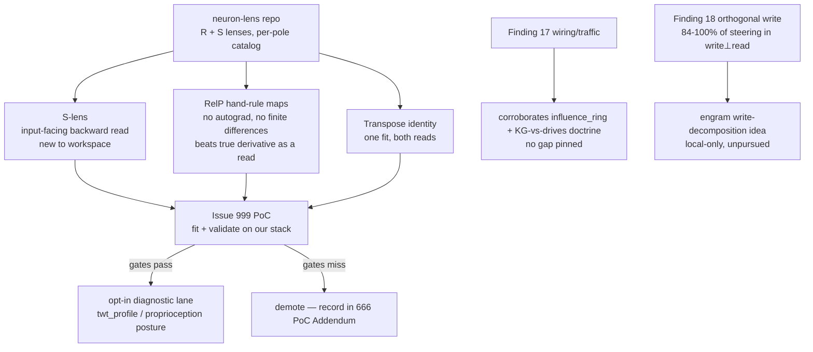

# Research 666: Neuron-Lens R/S Lenses — RelP-Linearized Transposable Lens Reads for Weight-Only Introspection

> **Source:** `stdlogits/neuron-lens` @ `849bfe1678e28becceb1e3864afe5fc8297d02e4` (shallow clone to `.raw/`, provenance pinned, removed post-verdict; MIT code/docs, CC BY 4.0 catalog + lenses on HF, models Apache-2.0). Site: neuron-lens.com. Companion lens artifacts: `stdlogits/rs-lenses` (R + S per model/modality: text/image/audio for Gemma 4).
> **Date:** 2026-11-12
> **Status:** Active — **Gain** (GOAT-conditional on the Issue 999 PoC). NOT Super-GOAT: Q1 fails on dense class prior art (logit/tuned/J/R/K lenses, RelP, ω-J, AttnLRP/MambaLRP; internal 388/475/625). §5 ping-pong negotiated this session (record §6).
> **Related Research:** **388** (Jacobian-lens single-layer readout — closest internal cousin; its prefilter REFUTATION binds cost discipline but is single-layer finite-difference scope, restated §2.2), 475 (ICA Lens — direction mining from activations; not weight-only, not unit-catalogued), 625 (Path Kernel — gradient-space similarity lens over GD-learned models), 605 (Spike/Sparse/Sink — the massive-activation/sink census line this repo's finding 9 corroborates), 258 + 566 (attention-sink mechanism lines), **reflex 011** (Proprioception — binds "the 388 cost lesson" to every lens-sweep serving signal; the consumer lane for input-facing reads)
> **Related Plans:** 409 (388's Fusion A PoC — COMPLETE, refuted as a FaithfulnessProbe prefilter)
> **Related Issues:** **999** (this note's PoC: hand-rule fit + validate on a real stack checkpoint)
> **Classification:** Public

---

## TL;DR

`neuron-lens` reads every MLP pole and attention head of Qwen3-8B and Gemma-4-12B from **weights alone** through two Jacobian lenses: **R-lens** (forward — corpus-averaged `J_L = mean_t Σ_{t'≥t} ∂h_final(t')/∂h_L(t)` under RelP rules; read `softmax(W_U · norm(J_L h))`; "what does this direction make the model say later" — predicts measured steering at median r 0.45–0.50 at L4–L8, 0.65–0.75 at L12–L16, ≥0.9 from L22; findings.md:189, at the pinned sha) and **S-lens** (backward — `K_L = mean_t Σ_{s≤t} ∂h_L(t)/∂e(s)`; token `v` scores `h · K_L (W_E[v] − mean(W_E))`; "which input tokens put this direction there" — names 38% of early poles' top firings in its top-10 at L0 vs <0.1% mismatched-pole control). Three elements are new to this workspace: (1) the **input-facing S read** — nothing here reads "which inputs put this latent direction there" from weights; (2) **RelP hand-rule linearization** — per-op linear maps (RMSNorm holds its rsqrt; `silu(g)` → `sigmoid(g)·dg`; `silu(g)·up` passes half each factor's change, β=0.5; attention/qk-norm/RoPE keep true derivatives) that make a lens a few matrix products with **no autograd and no finite differences**, and that measured BETTER than the true derivative as a read (R leads J-lens by 0.03–0.13 at L4–L23; J leads only at L0; RelP halves S-lens noise on the input side); (3) the **transpose identity** — the R-lens's map is exactly the transpose of the S-lens's map, so ONE linearized-stack fit serves both reads. Finding 17 (weight edges rank upstream effect at ρ=0.88 yet co-firing sources, not weight edges, carry a pole's live activation) independently corroborates the workspace's wiring-vs-traffic doctrine (`influence_ring`; KG triples = wiring, sigmoid drives = traffic). **Verdict: Gain** — this note + PoC issue 999; the introspection consumers are capability proposals, not wired products.

---

## 1. What the repo ships

- **A catalog** of every neuron pole (SwiGLU: `+` pole writes `+W_down[:,n]` and reads along `â+b̂`; `−` pole the reverse; GELU poles analogous) and attention head of two models, each read from three sides: weight-only lens reads (`reads`), activations over 15M positions (`acts`), exact token drivers (every common token swept at one position of 8 real documents, `drivers`), plus Claude Haiku labels (`labels`; $105 for 884,736 poles; detection-scored on held-out firings, AUROC 0.80 from lens reads alone).
- **Lens fits:** 1,000 DCLM docs × 128 tokens, ~3 h per text lens on one H100; one pass per basis direction of the fixed end covers every layer at the other end (d_model passes/doc, `dim_batch` blocks); fitted at two points per layer — `out` (layer output) and `mid` (MLP input). **The lens rule:** `out` reads MLP outputs + attention inputs; `mid` reads MLP inputs + attention outputs; reads elsewhere extrapolate and the catalog ships none.
- **A validation protocol** usable as a GOAT-gate template: steering as ground truth (add a pole's write at ~typical activation to 48 positions × 16 docs, correlate next-token log-prob deltas with the lens read; mismatched-pole control ±0.04), exact token sweeps as an input-side yardstick, held-out detection AUROC for labels, half-corpus fit stability (≤6% per layer; top-token agreement 89–99%).

---

## 2. Distillation

### 2.1 The three primitives new to this workspace

**(a) The S-lens input-facing read.** Forward lenses (logit/tuned/J/R — 388 distilled the J-lens) answer what a latent direction *causes downstream*. The S-lens answers the other half: **which inputs put this direction there**, read off `W_E` through the backward-averaged Jacobian. For serving-lane introspection (the reflex 011 proprioception line), the input-facing read is arguably the more useful instrument: it names the inputs that drive a lane's internal state, from weights, with a per-read cost of one matvec.

**(b) RelP hand-rule linearization (no-autograd derivative algebra).** Instead of finite differences (the workspace's only Jacobian machinery today: `jacobian_svd_at_into`, n+1 evals — exactly the cost class 388 REFUTED) or autograd (which our Rust stack does not have), RelP substitutes hand-written per-op propagation rules: LN rule (RMSNorm's rsqrt held constant), identity rule (`silu(g)` linearized as `sigmoid(g)·dg`), half rule (`silu(g)·up` passes half each factor's change, β=0.5), true derivative kept for attention, q/k norms, RoPE. Under the rules, each decoder layer over one document is a fixed linear map; `linearize` runs the model once per document and keeps the constants, `jvp`/`vjp` apply the map and its transpose "as a few matrix products" (transport.py:22-25, at the pinned sha). Their `rules.py` applies the same rules as autograd patches purely as the test reference against brute-force Jacobians. Empirically the approximation is a *better read* than the truth: R beats J-lens at predicting steering L4–L23, and RelP halves the S-lens's input-side noise (design.md §"RelP's rules").

**(c) The transpose identity.** "The R-lens's map is exactly the transpose of the S-lens's" (design.md) — one linearized stack fit yields both the forward (R) and backward (S) reads. Caveat: transposability is folklore-adjacent in the LRP family (AttnLRP/MambaLRP propagate relevance backward through transposed modified rules); the specific statement as an R↔S estimator-sharing identity is credited to this repo. Implementation consequence for us: fit ONCE per (checkpoint, fitting corpus), read in both directions forever.

**Cost posture (inference, not measurement):** fitting is offline, hours-class on the 4090 for our small checkpoints (laya encoder lane is ~0.6B-class; the repo's ~3 h figure is for an 8B on an H100); read-time is one matvec per direction. This is the answer to the cost lesson reflex 011 pins on every lens-sweep signal — the 388 refutation priced finite differences on a single-layer map; hand-rule maps for deep stacks price differently (offline fit amortized over all reads).

### 2.2 Signal-diff vs what ships (§3.6 discipline — every coverage dismissal read at the source)

| Shipped cousin | What it consumes | Lens primitive | Verdict |
|---|---|---|---|
| `jacobian_svd_at_into` (Plan 301) | pointwise finite-difference Jacobian of a GENERIC smooth `f: R^n→R^m` at one input | corpus-averaged hand-rule linearization of a KNOWN transformer stack; reads with `W_U`/`W_E`, not SVD; d_model passes vs n+1 evals | different signal + different cost class; complementary, no coverage |
| `FaithfulnessProbe` (Plan 278) | runtime interventions on the live map | offline-fitted read of frozen weights; per-read one matvec | complementary (388's refutation compared prefilter-vs-probe on ONE single-layer map; deep stacks have no per-layer probe handle at all) |
| FastICA lens (475 / Plan 475, shipped) | activations over data; mines directions | weight-only; names GIVEN units (poles/heads); no activation pass | complementary: dictionary-free direction mining vs unit-catalog reading |
| reflex 011 proprioception line | serving-lane internal-state signals (confidence probes, stability readouts) | the instrument class that line's cost lesson has been waiting for on deep lanes | consumer, not competitor |
| `influence_ring` (riir-games-shared) | data-flow overlap (wiring) vs observed co-firing (traffic) | finding 17's exact shape at transformer scale | corroboration — no gap pinned |

**Two-sided consumer check (step 4):** (a) *Game context* — finding 17 corroborates the KG-triples(=wiring)/sigmoid-drives(=traffic) split and `influence_ring`'s design at transformer scale; finding 18's orthogonal-write decomposition (`write ⊥ read` carries 84–100% of the steering effect, along-read only 8–34%, `r(whole,orth)` 0.94–1.00; findings.md:1315) is a closed-form, local-only write-decomposition idea for engram/consolidation writes ("store the addition") — recorded as an idea, unpursued until an engram consumer asks (the 388 Fusion-C lesson: don't wire diagnostics into the runtime without a claimant). (b) *Rulewright context* — one sentence per surface: (a) retrieval index: no lens-shaped consumer (index structure is not a trained stack); (b) trajectory memory/Elo: finding 17 says static structure ranks influence but selection is co-occurrence-driven — refine's Elo already learns from outcome traffic, so nothing is missing; (c) score-bench: no; (d) drafter-pruner selection: no; (e) rustc_errors playbooks: no. **No refine-side gap.**

### 2.3 The validation protocol = the GOAT-gate template (pre-registered in Issue 999)

- **G1 (S side):** S-lens top-10 of each L0-class pole's read direction contains the pole's held-out firing token at the repo's L0-class rate (their mean: 38% of top firings; mismatched-pole control <0.1%). The gate bar (≥25% hit / <1% control) is EXTRAPOLATED from their L0 figure — our checkpoint's early layers may hold no token-detector poles at all; in that case G1 reads **UNSEEN — no L0-class poles**, a scope finding recorded in the note, never a refutation of the estimator.
- **G2 (R side):** correlation of the R read of a write with measured steering effect at the matched depth band (their bar: 0.45+ mid-band; mismatched control ±0.04).
- **G3 (fit stability):** even/odd half-corpus fits agree ≤6% per layer.
- **G4 (cost):** read path = one matvec per direction, zero-alloc; fit cost recorded with box state.

### 2.4 Findings mapped to the stack

| finding | number | stack echo | action |
|---|---|---|---|
| Wiring in weights, traffic in context — weight edges rank upstream effect ρ=0.88, but the 64 largest **sources** (co-firing units) carry nearly all activation vs 64 weight edges ~a tenth | F17 | `influence_ring`; KG triples = wiring, sigmoid drives = traffic | corroboration; none |
| Two near-zero-scaled unembed dims hold 64% of final residual length and set the output temperature via the final norm; an L35 entropy neuron raises entropy on unpredictable tokens | F9 | the 605/258/566 sink line: a new specific mechanism (scale-carrier dims through RMSNorm) beside the activation-mass story | grep the sink census lanes on re-open |
| Orthogonal write: `write⊥read` carries 84–100% of steering; the along-read part 8–34% | F18 | engram/consolidation write decomposition idea | idea only, unpursued |
| Early layers (MLP0–8) write back detected token footprints — an extended embedding | F6 | embedding-tier reasoning for shallow stacks | diagnostic corroboration |
| Prediction/suppression poles: one neuron, two signs; prediction L20–31, suppression from L32 | F5 | pole bookkeeping for any future unit catalog | note only |

### 2.5 Consumer surfaces (honest, checkpoint-scoped)

- **⚠ The R side needs an LM head.** The laya encoder lane ships NO LM head — `riir-infer-laya/src/laya/riir/stability.rs:4-5` (verified this session): "The laya lane ships no LM head (no vocabulary unembed), so lens top-1 depth is not computable here… The headful lens variant stays deferred until a served checkpoint ships a head." So on laya only the S side (G1/G3, which read through `W_E`) is defined; G2 (R read vs next-token steering) is N/A there. The R side's primary PoC checkpoint is a HEADFUL small model already on disk: `riir-train/data/Qwen3.5-0.8B-Base-Q8_0.gguf` (the closed-form-write cell's model), else a small katgpt-core LM. The fit IS the deferred "headful lens variant" the stability lane names.
- **The consumer anchor is live in code.** The stability lane ships the head-free analog today (residual-state stabilization readout; tests `issue1106_stability_capture_smoke.rs` + `stability_g4_alloc.rs` in `riir-infer-laya/tests/`; the headful per-stage unembed top-1 definition is pinned in riir-infer's Issue 1106 record + reflex 011) — the originating issue FILES are no longer on disk, but the lane and its tests are. A passing PoC gives that lane its deferred headful instrument plus the input-facing S read.
- **katgpt-core transformer primitives:** the same estimator class; the transpose fit is d_model passes per doc — feasible on this box.
- **reflex (public) / rethink (private):** input-facing reads serve the proprioception/trust story. **No rethink-tier content appears anywhere in this note** (public classification holds; ESC/economy/vessel surfaces untouched).
- **riir-train: none** — fitting is an average of exact linearizations, no training objective; the media "optimised patch" is gradient ascent on an INPUT (a test-time probe), not weight training. No §3.5 deferral arises; no adversarial panel needed (no training-adjacent classification).

---

## 3. Verdict

**Tier: Gain (GOAT-conditional on Issue 999).** Not Super-GOAT.

**Pinned claim (§4 precondition form):** *RelP hand-rule transposable lens estimation + the S-lens input-facing read* for *weight-only introspection of fixed-weight serving lanes (R side: a headful small checkpoint — Qwen3.5-0.8B-class or a katgpt-core LM; S side additionally on the headless laya encoder lane)*, consuming *weights + a ~1k-doc fitting corpus*, distinguished from *388's single-layer finite-difference J-lens (prefilter-refuted) and 475's activation-mined FastICA* by *the backward input-facing read + no-autograd hand-rule linearization + the one-fit-two-reads transpose identity*.

### 3.1 Novelty gate (§1.5, explicit)

| Q | Answer |
|---|---|
| **Q1 — No prior art?** | **NO (class level).** Published: logit lens (nostalgebraist 2020), tuned lens (arXiv:2303.08112), J-lens (Gurnee et al. 2026 — internally distilled as 388), R-lens (camilablank/agam_bhatia/Neel Nanda 2026), K-lens (Vogel 2026, unpublished), RelP (arXiv:2508.21258), ω-J-lenses (arXiv:2610.31955, "A Mathematical Theory of the Jacobian Lens" — verified resolving 2026-11-12), DeltaTrace (arXiv:2610.25877, verified resolving — composes OPERATOR-SPECIFIC LOCAL RULES backward through the computational graph: the same hand-rule family, attribution-scoped), AttnLRP (arXiv:2402.05602), MambaLRP (arXiv:2406.07592), Qwen-Scope (arXiv:2605.11887). Internal: 388 (forward J-lens), 475, 625; workspace grep for `k-lens|s-lens|input-facing` = ZERO hits — **the S-lens as such is introduced by this repo and new to the workspace**, but the estimator class is dense prior art. |
| **Q2 — New behavior class?** | **YES for the workspace** (weight-only input-facing reads of deep stacks do not exist here; our only Jacobian machinery is pointwise finite differences on single-layer maps). |
| **Q3 — Product selling point?** | **Partial** — "our decision lanes can name which inputs drive any internal direction, from weights alone" is a real trust/proprioception selling point, but it is contingent on the PoC AND on a consumer lane claiming it. |
| **Q4 — Force multiplier?** | **YES** — connects riir-infer lanes + katgpt-core Jacobian machinery + the sink census line (605/258/566) + the proprioception line (reflex 011). |

Q1 fails ⇒ **not Super-GOAT.** Q2+Q4 yes with Q3 partial ⇒ GOAT-conditional Gain; per the ungoat law the proof path is pre-registered (Issue 999) before any promotion talk.

### 3.2 MOAT gate + tier routing

- **katgpt-rs — IN (this note, public).** The primitive is generic modelless inference math; substrate home would be katgpt-core (estimator) / riir-infer (checkpoint-specific maps).
- **riir-ai — consumer-only** (diagnostic posture, sync law intact: any synced signal stays the HLA 5-scalar law; 388 Fusion C's not-pursued verdict stands for adaptive-basis replacement — the lens reads are LOCAL diagnostics and never cross sync).
- **riir-chain / riir-neuron-db — out of scope.** (A speculative S-lens-over-shard-style_weights read is noted here only as vocabulary: "which inputs shaped this shard direction" is what shard readouts already answer from stored rows — no storage-side primitive arises.)
- **riir-train — no content.**

### 3.3 Latent-vs-raw boundary

Lens reads operate on latent directions and produce token-ranking diagnostics — local-only. Nothing here crosses the sync boundary; if a lane ever syncs a lens-derived scalar, it goes through the HLA 5-scalar bridge (dot + sigmoid), never the direction.

---

## 4. Routing decisions

| Item | Destination | Action |
|---|---|---|
| Research note | `katgpt-rs/.research/666_Neuron_Lens_RS_Transposable_Lens_Reads.md` (this file) | ✅ created |
| PoC spec | `katgpt-rs/.issues/999_rs_lens_fit_validate_poc.md` | ✅ created (fusion idea, novelty-TBD discipline; unclaimed; primary checkpoint re-scoped to a HEADFUL model in round 1 — laya is S-only) |
| 388 forward reference | `.research/388_…md` Related Research line | ✅ +1 line (the delta + refutation-scope note) |
| Plan | — | NOT opened (no consumer claimed; ungoat law) |
| riir-train | — | nothing (no training content) |
| `.raw/neuron-lens` | removed post-verdict | provenance = sha `849bfe16` in this header |

---

## 5. PoC pointer

The runnable proof path lives in Issue 999 (hand-rule maps → fit on a real checkpoint → pre-registered gates G1–G4 → demote on miss). Source mechanics for the implementer, at the pinned sha: `neuron_lens/transport.py` (Accumulator/mean, d_model basis sweeps, dim_batch blocks), `neuron_lens/layers.py` (hand-written per-component maps — RMSNorm, softmax attention with grouped heads, q/k and value norms, partial RoPE, masks, GDN, gated/sparse MLPs — composed per model family), `neuron_lens/rules.py` (the same rules as autograd patches — the test reference for our finite-difference cross-check).

---

## 6. §5 ping-pong record

- **Round 1 — REVISE (claude_code reviewer, session `6a0fb2df`).** Reasons + dispositions: (1) BLOCKING — the laya lane ships no LM head (verified at `stability.rs:4-5`), so the R-lens read and G2 are undefined there → T1 re-scoped to a headful primary checkpoint (`Qwen3.5-0.8B` on disk / small katgpt-core LM), laya kept as S-only (G1/G3; G2 N/A); §2.5 + pinned claim updated to match. (2) The consumer lane is LIVE IN CODE (`issue1106_stability_capture_smoke.rs`, `stability_g4_alloc.rs`, the headful-lens-variant deferral pinned in `stability.rs`) → §2.5 now cites the code anchor instead of "no lane on disk"; the PoC fills that lane's explicitly deferred headful variant. (3) Housekeeping → `.raw/neuron-lens` deleted before commit (sha pinned in the header); §6 this record; Issue 999 status moved to line 2. (4) arXiv:2610.31955 + 2610.25877 verified resolving (fetch 2026-11-12); DeltaTrace's backward local-rule composition noted in Q1. (5) G1 bar marked EXTRAPOLATED with an UNSEEN — no L0-class poles fallback (scope finding, never a refutation).
- **Round 2 — AGREE (same session, `final_round`).** All five round-1 dispositions confirmed fixed. Two non-blocking notes folded into Issue 999 T2: Qwen3.5-0.8B is a GDN+attention hybrid, so T2 now requires the GDN recurrence map (true derivative, ported from upstream `layers.py`) — without it the transpose test covers only the attention layers; and the fit runs on dequantized f32 weights (the GGUF is Q8_0) so G3 stability is not a quantization artifact. Commit staged to the five named files; `.raw/neuron-lens` deleted immediately before it.
